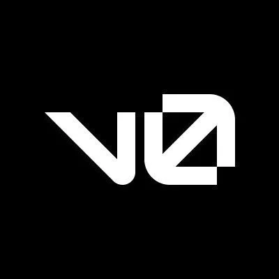
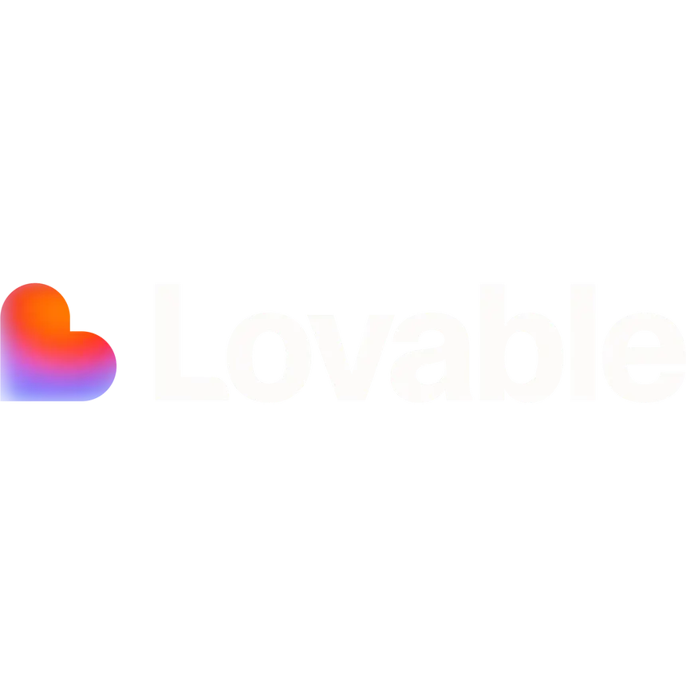
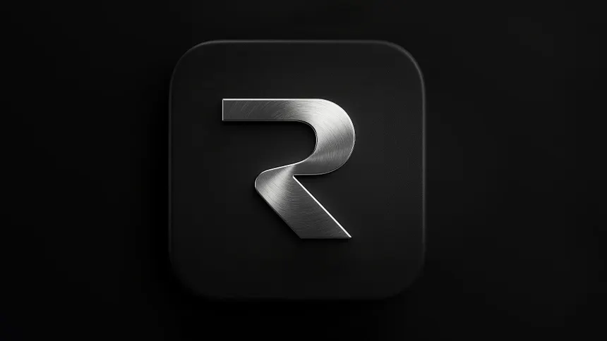
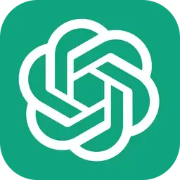
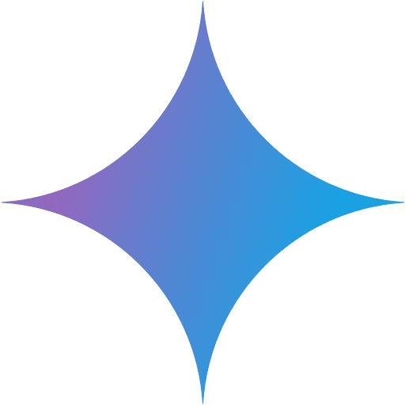
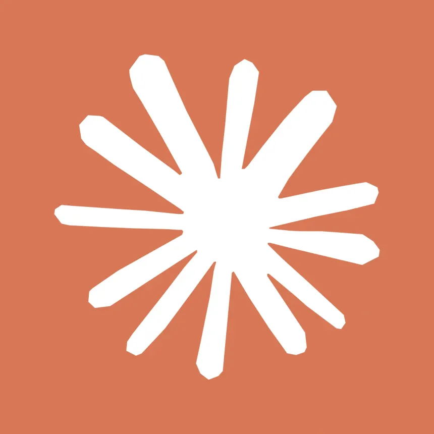

---

## < Sobre />

Sou **João Batista**, desenvolvedor front-end em formação, atualmente no 4º período de Análise e Desenvolvimento de Sistemas no **Centro Universitário UNIFAFIRE**, com formação técnica em TI pelo Senac.

Tenho grande interesse em **desenvolvimento de interfaces e experiência do usuário**, buscando criar aplicações que unam funcionalidade, clareza visual e usabilidade. Também possuo afinidade com design de interfaces e prototipação, o que contribui para uma visão mais estratégica na construção de produtos digitais.

Além do desenvolvimento, sou criador do projeto **Frontista**, perfil onde compartilho minha evolução na área da tecnologia, estudos, projetos, processos criativos e minha trajetória, usando as redes sociais como forma de documentar aprendizado, trocar conhecimento e inspirar outras pessoas que também estão construindo seu caminho na programação.

Participei de projetos acadêmicos e colaborativos que fortaleceram minhas habilidades em trabalho em equipe, organização, comunicação e resolução de problemas. Busco constantemente evoluir profissionalmente, aprendendo novas tecnologias e desenvolvendo soluções cada vez mais eficientes e bem estruturadas.

Paulista, PE 📍

---

## < Portfólio />

*Todos os projetos reunidos, com o detalhe técnico de cada um.*

---

## < Habilidades />

 

<table>
  <tr>
    <th>💻 Linguagens</th>
    <th>🎨 Front-end</th>
    <th>⚙️ Back-end</th>
    <th>🗄️ Databases</th>
  </tr>
  <tr>
    <td align="center" valign="top">
      
    </td>
    <td align="center" valign="top">
      
    </td>
    <td align="center" valign="top">
      
    </td>
    <td align="center" valign="top">
      
    </td>
  </tr>
</table>

 

<table>
  <tr>
    <th>📐 Prototipação</th>
    <th>🚀 Deploy & Tools</th>
    <th>📩 Mensageria & APIs</th>
    <th>🤖 IA & Produtividade</th>
  </tr>
  <tr>
    <td align="center" valign="top">
      
       
      
      
    </td>
    <td align="center" valign="top">
      
    </td>
    <td align="center" valign="top">
      
    </td>
    <td align="center" valign="top">
      
      
      
    </td>
  </tr>
</table>

 

🇧🇷 Português · Nativo &nbsp;&nbsp;|&nbsp;&nbsp; 🇺🇸 Inglês · Intermediário &nbsp;&nbsp;|&nbsp;&nbsp; 🇪🇸 Espanhol · Intermediário

---

## < Projetos />

<table width="100%">
  <tr>
    <td width="50%" valign="top">
      
      

      
Plataforma cívica do Recife: o cidadão relata problemas num mapa 3D e o poder público responde e publica a obra.

      
<b>Papel:</b> Líder da equipe 🎓 Projeto do 4º período (time de 3) <b>Período:</b> Ago 2026 até o momento

      

      
 

    </td>
    <td width="50%" valign="top">
      
      

      
Marketplace de NFTs com preço e estoque em tempo real, checkout idempotente, API simulada (MSW) e 41 testes E2E.

      
<b>Papel:</b> Desenvolvedor Front-end 💡 Projeto pessoal (solo) <b>Período:</b> Out 2026

      

      
 

    </td>
  </tr>
  <tr>
    <td width="50%" valign="top">
      
      

      
Estúdio criativo com IA para farmácias: cada peça mostra suas fontes e passa por um checklist da Anvisa.

      
<b>Papel:</b> Product Owner & dev principal 🏆 Hacka Business Avanade (time de 3) <b>Período:</b> Out 2026

      

      
 

    </td>
    <td width="50%" valign="top">
      
      

      
Landing page de moda costurada por um fio animado que segue a rolagem, com pedido montado direto no WhatsApp.

      
<b>Papel:</b> Desenvolvedor Front-end 💡 Projeto pessoal (solo) <b>Período:</b> Out 2026

      

      
 

    </td>
  </tr>
  <tr>
    <td width="50%" valign="top">
      
      

      
E-commerce de brinquedos fictícios com busca, filtros, carrinho, favoritos e checkout simulado em etapas.

      
<b>Papel:</b> Desenvolvedor Front-end 💡 Projeto pessoal (solo) <b>Período:</b> Set 2026

      

      
 

    </td>
    <td width="50%" valign="top">
      
      

      
Agendamento para barbearias: o cliente marca pelo link, o barbeiro usa o painel e os lembretes vão por e-mail.

      
<b>Papel:</b> Desenvolvedor Full-stack 💡 Projeto pessoal (solo) <b>Período:</b> Jun a Set 2026

      

      
 

    </td>
  </tr>
  <tr>
    <td width="50%" valign="top">
      
      

      
Gestão do conhecimento corporativo: documentos, procedimentos e avisos num lugar só, com acesso por cargo.

      
<b>Papel:</b> Desenvolvedor Full-stack 🏢 Feito para o Grupo ACLF (solo) <b>Período:</b> Mai a Jul 2026

      

      
 

    </td>
    <td width="50%" valign="top">
      
      

      
Conecta jovens talentos do Nordeste a vagas, cursos e eventos, com uma IA que identifica habilidades em conversas.

      
<b>Papel:</b> Co-líder & Scrum Master 🥇 1º lugar na UNIFAFIRE (time de 5) <b>Período:</b> Fev a Jun 2026

      

      
 

    </td>
  </tr>
  <tr>
    <td width="50%" valign="top">
      
      

      
Gestão de doações para ONGs: controle de estoque, recebimento e distribuição de itens aos beneficiários.

      
<b>Papel:</b> Co-líder & Scrum Master 🥈 2º lugar na UNIFAFIRE (time de 5) <b>Período:</b> Jul a Dez 2025

      

      
 

    </td>
    <td width="50%" valign="top">
      
      

      
Jogo educativo inspirado em Pokémon que ensina higiene e o combate às bactérias a crianças de 6 a 10 anos.

      
<b>Papel:</b> Dev & Editor do Trailer 🥇 1º lugar entre 8 equipes <b>Período:</b> Fev a Jul 2025

      
 

      
 

    </td>
  </tr>
</table>

---

